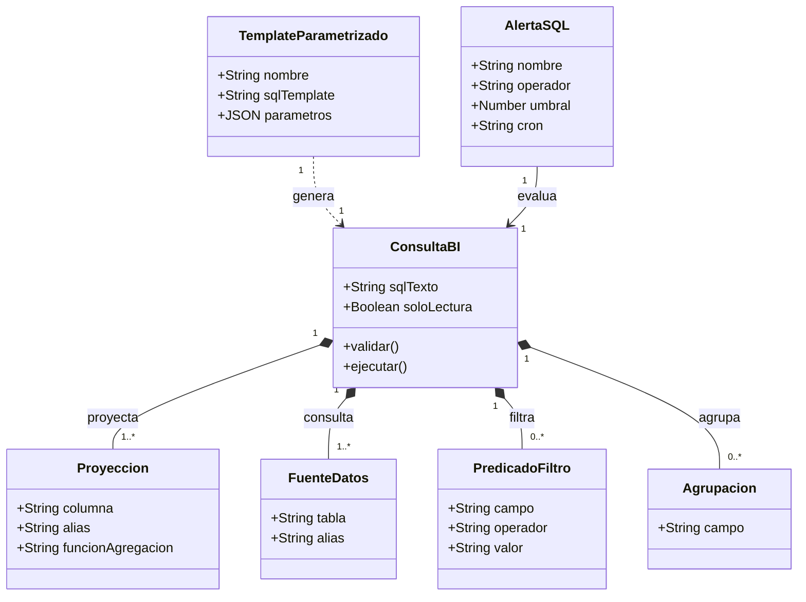

# Entregable Técnico — Proyecto 2: `.SQL-BI`
**Curso:** SW608 Lenguajes de Dominio Específico (DSL) — UNI FIIS (2026-II)  
**Docente:** Ing. Jorge Medianero Acosta

---

## 1. Bases Teóricas y Fundamentación
Un **Lenguaje de Dominio Específico (DSL)** es un lenguaje diseñado para expresar soluciones dentro de un dominio acotado con un nivel de abstracción cercano al problema. En el análisis de datos (*Business Intelligence*), **SQL** actúa como un DSL textual declarativo basado en álgebra relacional: el analista describe *qué* métricas y agregaciones necesita, delegando al motor (PostgreSQL) *cómo* ejecutar joins, índices y agrupaciones.

En `.SQL-BI`, SQL se combina con:
- **Introspección de esquema (`information_schema`)** para autocompletado en tiempo real en Monaco Editor.
- **Análisis sintáctico (AST con `node-sql-parser`)** para garantizar un subconjunto seguro de **solo lectura (`SELECT`)**.
- **Parametrización (`{{variable}}`)** para reutilización de consultas mediante templates.

---

## 2. Justificación del DSL
¿Por qué usar SQL autocompletado en lugar de un lenguaje de propósito general (como JavaScript puro)?
1. **Declaratividad**: Un `GROUP BY` + `SUM()` + `JOIN` expresa en 5 líneas lo que en JS imperativo requiere bucles anidados, diccionarios de agrupación y manejo manual de nulos.
2. **Seguridad verificable**: Al restringir la gramática del DSL mediante AST a sentencias `SELECT`, se elimina el riesgo de mutación de datos (`DROP`, `DELETE`, `UPDATE`, `INSERT`).
3. **Productividad (Criterio de éxito)**: Un analista obtiene un KPI nuevo en **< 2 minutos** usando autocompletado y templates, frente a horas o días de desarrollo ad-hoc en backend.

---

## 3. Demostración de Abstracción
### Sin DSL (JavaScript imperativo sobre arreglos en memoria — ~30 líneas)
```javascript
const totalsByChannel = {};
for (const v of ventas) {
  if (v.estado !== 'completada') continue;
  const canal = canales.find(c => c.id === v.canal_id);
  const key = canal ? canal.nombre : 'Desconocido';
  if (!totalsByChannel[key]) totalsByChannel[key] = { canal: key, ordenes: 0, ingresos: 0 };
  totalsByChannel[key].ordenes += 1;
  totalsByChannel[key].ingresos += Number(v.total);
}
const result = Object.values(totalsByChannel).sort((a, b) => b.ingresos - a.ingresos);
```

### Con DSL (`.SQL-BI` — 6 líneas legibles)
```sql
SELECT c.nombre AS canal, COUNT(v.id) AS ordenes, SUM(v.total) AS ingresos
FROM ventas v
JOIN canales c ON c.id = v.canal_id
WHERE v.estado = 'completada'
GROUP BY c.nombre
ORDER BY ingresos DESC;
```

---

## 4. Metamodelo del DSL



### Mapeo Sintaxis Abstracta → Sintaxis Concreta
| Metaclase | Concepto del Dominio | Sintaxis Concreta (SQL / `.SQL-BI`) |
|---|---|---|
| `ConsultaBI` | Consulta analítica de solo lectura | `SELECT ... FROM ...` |
| `Proyeccion` | Métrica o dimensión | `c.nombre AS canal, SUM(v.total) AS ingresos` |
| `FuenteDatos` | Tabla o relación | `FROM ventas v JOIN canales c ON ...` |
| `PredicadoFiltro` | Condición de negocio | `WHERE v.estado = 'completada'` |
| `Agrupacion` | Dimensión de agregación | `GROUP BY c.nombre` |
| `TemplateParametrizado` | Consulta reutilizable | `{{fecha_inicio}}`, `{{categoria}}` |
| `AlertaSQL` | Regla de monitoreo | `condicion_sql` + `operador` (`>`) + `umbral` |

---

## 5. Especificación de Requisitos (Caso de Uso + Gherkin/BDD)

### Caso de Uso Principal: `UC-001` — Análisis Self-Service de Ventas
- **Actor:** Analista de Negocio / Usuario no técnico.
- **Precondiciones:** Base de datos PostgreSQL conectada con esquema de ventas retail multicanal.
- **Postcondiciones:** Consulta validada en modo solo lectura, ejecutada y visualizada en tabla y gráfico D3.js.

### Historias de Usuario (Formato Given/When/Then)

#### `US-01`: Validación y bloqueo de sentencias de escritura
- **Como** administrador de datos, **quiero** que el editor bloquee cualquier sentencia `DROP`, `DELETE`, `UPDATE` o `INSERT`, **para** proteger la integridad de la base de datos.
```gherkin
Feature: Modo solo lectura obligatorio
  Scenario: Bloqueo de sentencia destructiva
    Given el analista está en el editor SQL de ".SQL-BI"
    When escribe "DROP TABLE ventas;" y presiona Ejecutar
    Then el parser SQL rechaza la consulta
    And muestra el mensaje "Operación bloqueada: solo se permiten consultas de lectura (SELECT)"
```

#### `US-02`: Ejecución de Template Parametrizado y Visualización D3.js
- **Como** analista de ventas, **quiero** seleccionar un template con variables `{{fecha_inicio}}` y ver el resultado en un gráfico D3.js, **para** obtener KPIs sin escribir SQL desde cero.
```gherkin
Feature: Templates parametrizables y gráficos D3.js
  Scenario: Ejecutar template de ventas por canal
    Given el analista selecciona el template "Ventas por Canal en Rango"
    When ingresa fecha_inicio "2026-01-01" y fecha_fin "2026-12-31" y ejecuta
    Then el sistema renderiza la tabla de resultados
    And actualiza el gráfico interactivo en la pestaña "Visualización D3.js"
```

#### `US-03`: Versionado de Consultas y Rollback
- **Como** analista, **quiero** guardar revisiones de mis consultas y poder restaurar una versión anterior, **para** no perder cambios al iterar sobre un KPI.
```gherkin
Feature: Versionado y rollback de consultas
  Scenario: Restaurar una versión previa
    Given existe la consulta "Ingresos Mensuales 2026" con versiones v1 y v2
    When el analista abre el historial y selecciona "Restaurar v1"
    Then el editor carga el SQL de la v1
    And la versión activa pasa a ser v1
```

---

## 6. Guión de Demostración en Vivo (Casos de Prueba)
1. **Autocompletado**: Escribir `SELECT ` en Monaco Editor y mostrar sugerencias de tablas (`ventas`, `canales`, `productos`) cargadas desde `information_schema`.
2. **Bloqueo Solo Lectura**: Escribir `DELETE FROM ventas;` y verificar la barra roja de validación en tiempo real y el bloqueo en `/api/query/execute`.
3. **Template Parametrizado + D3.js**: Seleccionar *"Ventas por Canal en Rango"*, ejecutar (`Ctrl+Enter`) y cambiar a la pestaña **Visualización D3.js** (barras y líneas).
4. **Versionado y Rollback**: Guardar una nueva revisión de una consulta y hacer rollback a `v1`.
5. **Motor de Alertas**: Hacer clic en la alerta *"Ventas Anuladas Altas"* para evaluarla en vivo y verificar su disparo.
